# Website Framework

A reusable, conversion-focused framework for a small-business website. It has three page types: **Homepage**, **Service page** and **Landing page** (for one offer, such as a free assessment).

First used for VDW Health & Safety Solutions. The original wireframes are in `framework/wireframes/` and shown under each page below. The working example is in `prototype/` (`index.html`, `gap-audit.html`, `safety-file.html`, `compliance-management.html`, `free-assessment.html`).

---

## How to use this for a new business

Start a new conversation and attach this file. Then give Claude:

1. **Business basics:** name, logo, phone, email, location and areas served.
2. **Main offer:** the one action you want visitors to take (for example "Book a Free Site Assessment") and where it links.
3. **Services:** each service with what's included, turnaround, who it's for and any bonuses.
4. **Proof:** real testimonials (name or role, company type, area), real stats and case studies.
5. **Guarantee:** your exact wording, or say "no-obligation promise only".
6. **SEO keywords:** one per page, for example "[service] in [city]".
7. **Photos:** team, site and work photos, if you have them.

Then say: *"Build the homepage, service pages and landing page using this framework, as a prototype first."*

Ground rules that worked well:
- Upload wireframes in batches (or point Claude to the ones in `framework/wireframes/`), and only start building on **"go"**.
- Build as a **prototype** in its own folder first, and leave any live site untouched.
- Publish a private preview link to review on desktop and phone.
- Never invent testimonials, guarantees, prices or stats. Mark placeholders clearly and confirm them before going live.

---

## Page 1: Homepage (17 sections)

### Wireframes

The original wireframes for this page, top to bottom.

**1. Header, hero and social proof #2 strip**

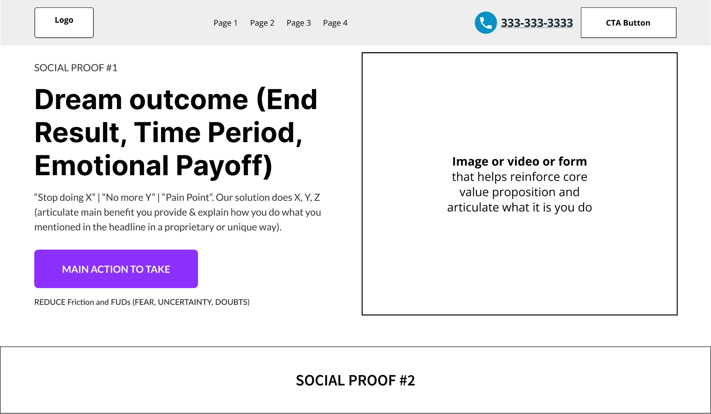

**2. Social proof: 3 cards**

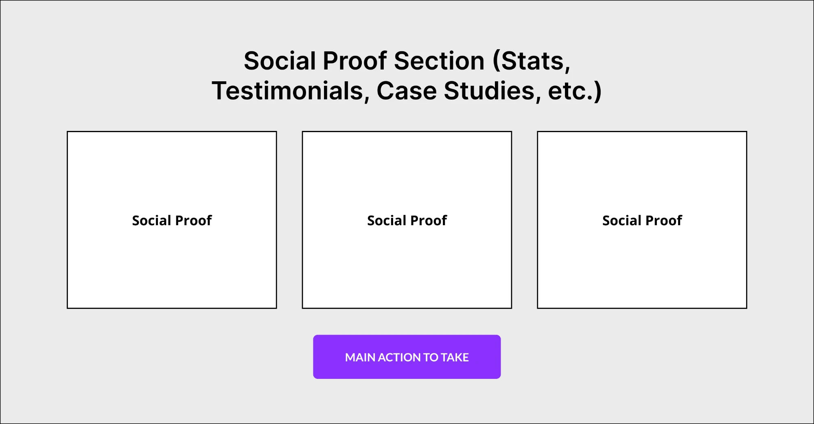

**3. Pain point**

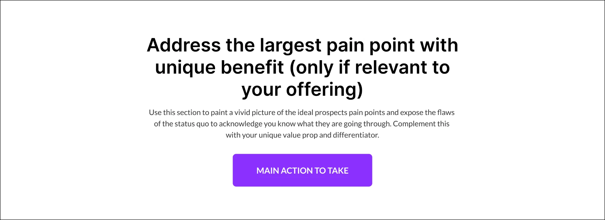

**4. Value prop #1 (image left)**

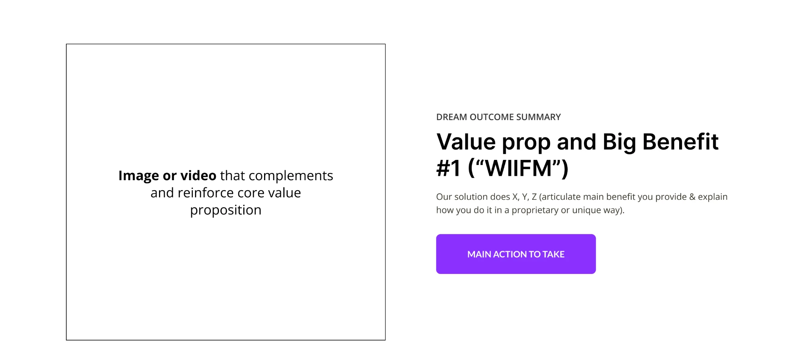

**5. Value prop #2 (image right)**

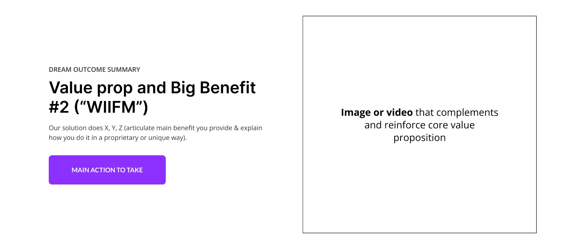

**6. Value prop #3 (image left)**

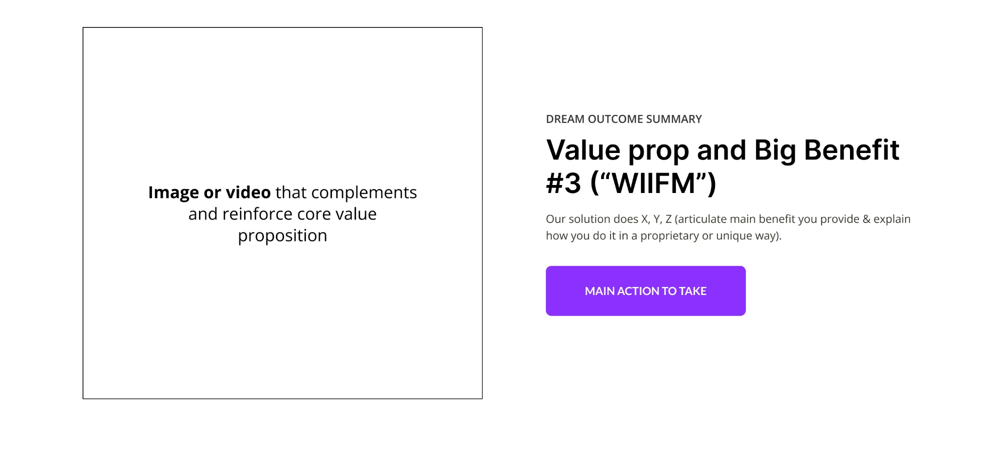

**7. Services: 3 cards**

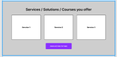

**8. Social proof: 1 wide card**

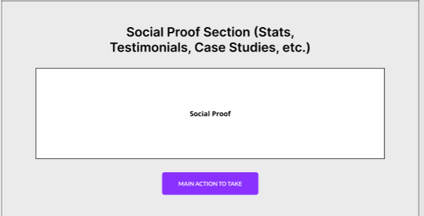

**9. Differentiators: 6 cards**

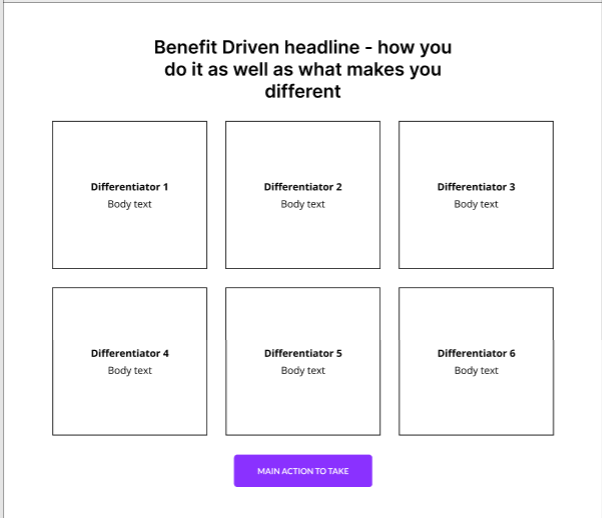

**10. How it works, meet the team, social proof #2 strip**

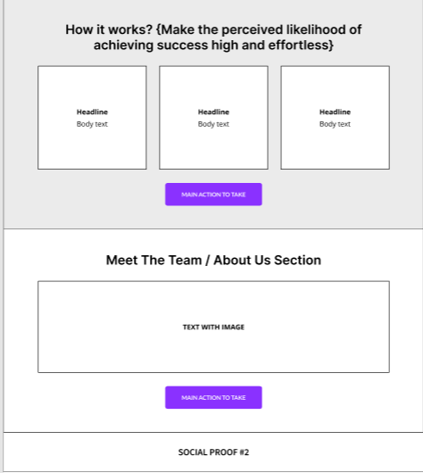

**11. FAQ and blog / locations section**

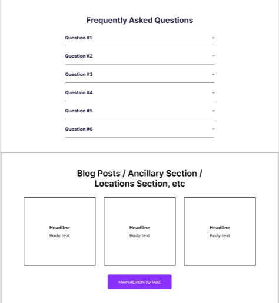

**12. Final recap and footer**

### Sections

| # | Section | Purpose and content |
|---|---------|-------------------|
| 1 | **Header** | Logo, 3 to 5 page links, phone number with icon, outline CTA button. Sticky. |
| 2 | **Hero** | Eyebrow (social proof #1) · big "dream outcome" headline (end result, time period, emotional payoff) · pain-point subtext ("Stop X / No more Y", then how you solve it) · main CTA button · one line to reduce friction and doubts (FUD), such as "No obligation · No jargon". Right side: image, video, form or offer card. |
| 3 | **Social proof #2 strip** | Dark band with 4 short trust points (accreditation, specialisms, turnaround, location). |
| 4 | **Social proof: 3 cards** | Grey background · 3 testimonials · CTA. |
| 5 | **Pain point** | Centered headline on the biggest pain point · paragraph exposing "the old way" and tying in your unique benefit · CTA. |
| 6 | **Value prop #1** | Image left, text right: eyebrow · benefit headline (WIIFM) · body · CTA. |
| 7 | **Value prop #2** | Same, flipped (text left, image right). |
| 8 | **Value prop #3** | Image left again. |
| 9 | **Services** | Grey · 3 service cards (tag, title, short description, 3 ticks, "Learn more" link to the service page) · CTA. |
| 10 | **Social proof: 1 wide card** | Stats row (4 numbers with labels) or one featured case study · CTA. |
| 11 | **Differentiators** | Benefit headline on how you do it and what makes you different · 6 cards (icon, title, one line) in a 3x2 grid · CTA. |
| 12 | **How it works** | Grey · 3 numbered steps that make success feel likely and effortless · CTA. |
| 13 | **Meet the team / About** | Text with image · CTA. Then a **Social proof #2 strip** ("Trusted by" industries or client types). |
| 14 | **FAQ** | 6 questions in an accordion that opens one at a time. Answer the real objections: cost, time, area, process, "what happens next", "how do I start". |
| 15 | **Ancillary section** | 3 cards: blog posts, locations or areas served · CTA. |
| 16 | **Final recap** | Grey · urgency headline ("why act today") · body · checklist of the 3 value props · big CTA · FUD line. Image on the right. |
| 17 | **Footer** | Logo and one-line description · Services links · Company links · contact details · copyright. |

## Page 2: Service page (one per service)

Same header and footer as the homepage, with the current page highlighted in the menu.

### Wireframes

The original wireframes for this page, top to bottom.

**1. Header, hero (SEO keyword H1) and social proof #2 strip**

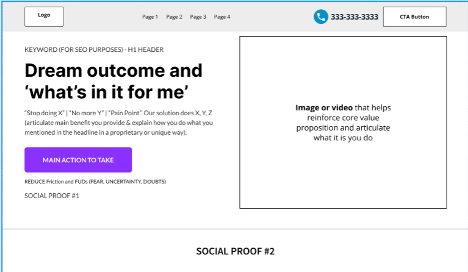

**2. Pain point and social proof: 3 cards**

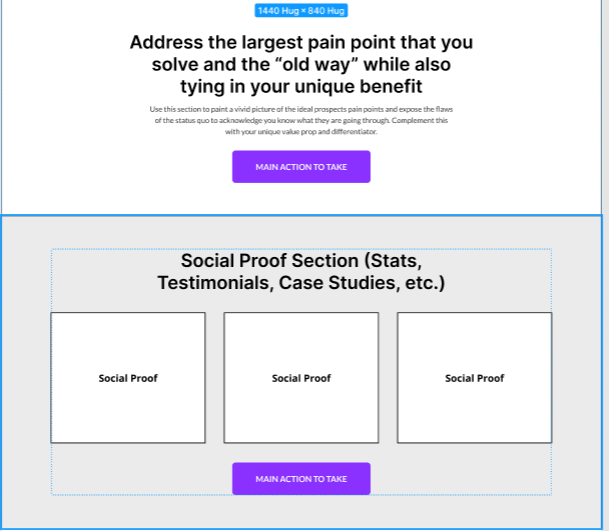

**3. Social proof: 3 cards**

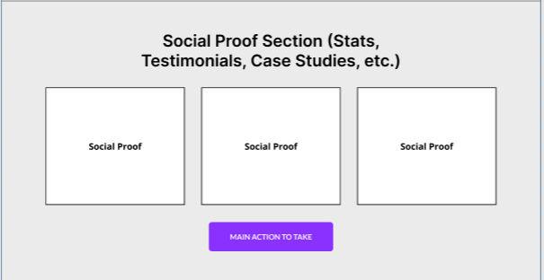

**4. Value props #1 and #2**

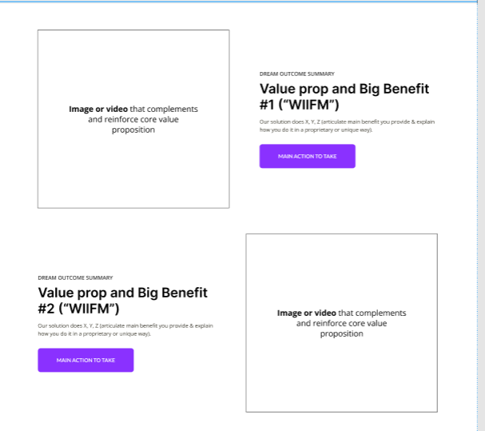

**5. Value prop #3 and social proof: 1 wide card**

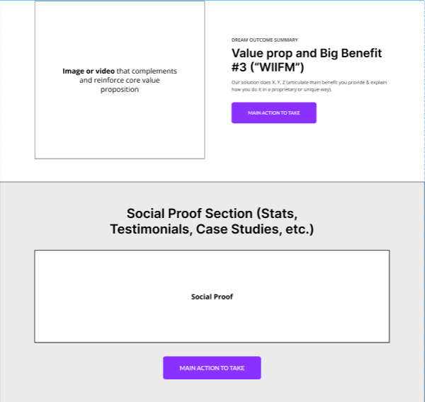

**6. Differentiators: 6 cards**

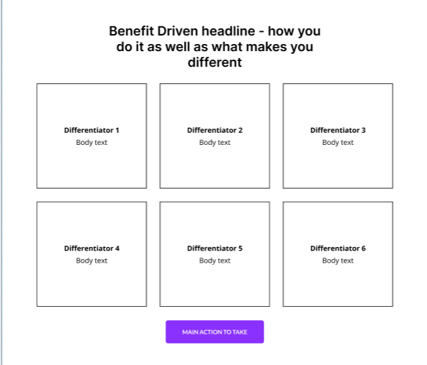

**7. How it works**

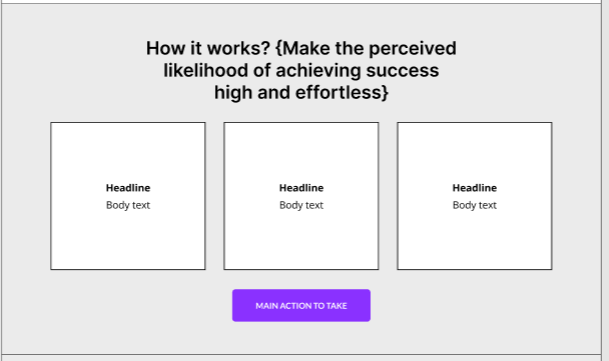

**8. Meet the team and social proof #2 strip**

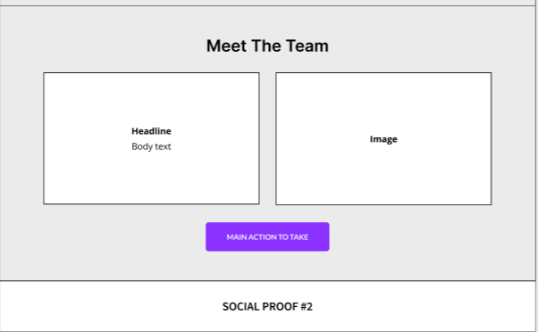

**9. FAQ**

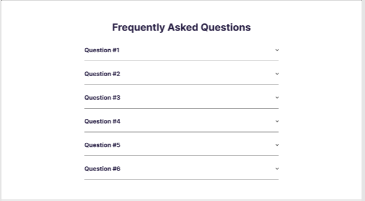

**10. Final recap and footer**

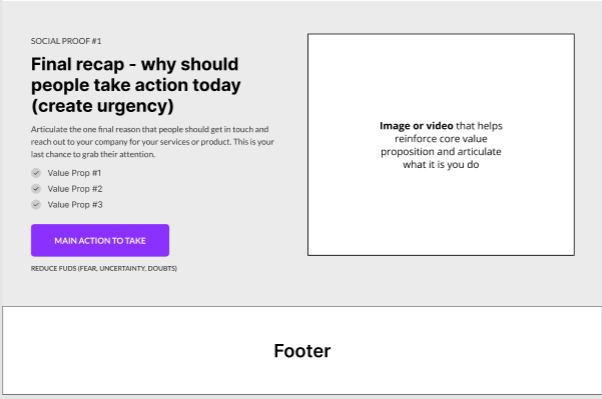

### Sections

| # | Section | Purpose and content |
|---|---------|-------------------|
| 1 | **Hero** | **Small H1 = SEO keyword** (for example "Health & Safety File Development in Pretoria") · big headline = dream outcome / WIIFM (styled large, not the H1) · pain-point subtext · CTA · FUD line · social proof #1 line (stars and "Trusted by..."). Image right. |
| 2 | **Social proof #2 strip** | 4 service-specific trust points. |
| 3 | **Pain point** | The "old way" compared with your unique benefit · CTA. |
| 4 | **Social proof: 3 cards** | 3 stats or facts specific to this service · CTA. |
| 5 | **Social proof: 3 cards** | Industries or client types served · CTA. |
| 6 to 8 | **Value props #1 to #3** | Alternating image and text, each with its own CTA wording. |
| 9 | **Social proof: 1 wide card** | One featured testimonial for this service · CTA. |
| 10 | **Differentiators** | "What's included", 6 cards · CTA. |
| 11 | **How it works** | 3 steps for this service, with a one-line timeline subtitle · CTA. |
| 12 | **Meet the team** | Text card and photo side by side · CTA. Then a **Social proof #2 strip**. |
| 13 | **FAQ** | 6 service-specific questions. Include a cost question that answers "quote after the free assessment" unless real prices are given. |
| 14 | **Final recap** | Urgency headline · 3-point checklist · CTA · FUD. Image right. |
| 15 | **Footer** | |

## Page 3: Landing page (one offer, such as a free assessment)

**No site menu.** The header has only the logo (links home), a small "← Back to website" link, the phone number and a CTA button. Every button goes to the one offer. Minimal footer: logo, contact, "← Back to website", copyright.

### Wireframes

The original wireframes for this page, top to bottom.

**1. Header (no menu), hero and social proof #2 strip**

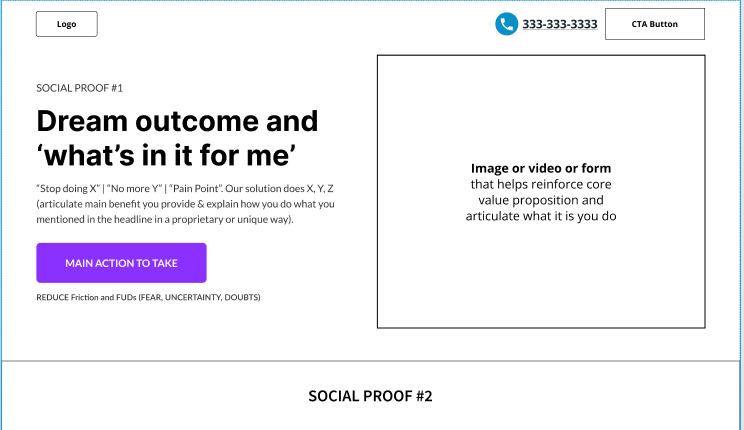

**2. Social proof: 3 cards**

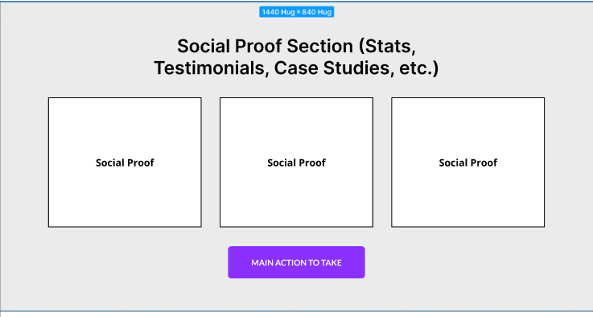

**3. Pain point and value prop #1**

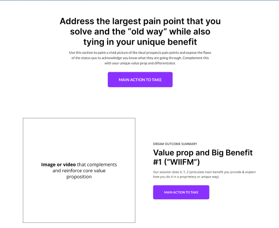

**4. Value props #2 and #3**

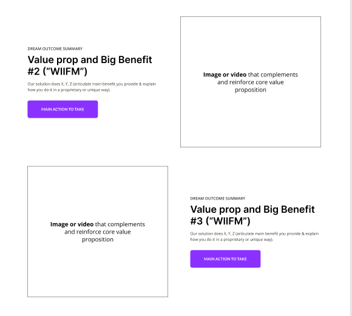

**5. Social proof: 1 wide card**

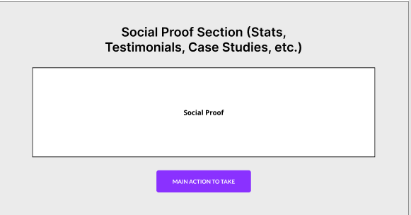

**6. Differentiators: 6 cards**

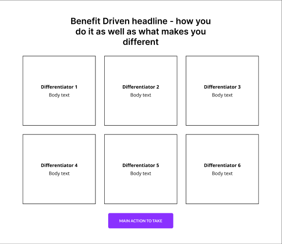

**7. How it works**

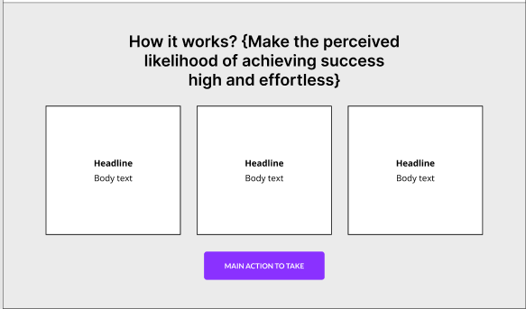

**8. Meet the team**

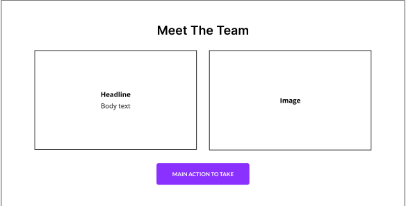

**9. Guarantee (optional) and social proof #2 strip**

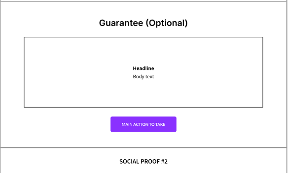

**10. FAQ**

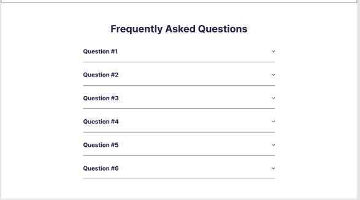

**11. Final recap and footer**

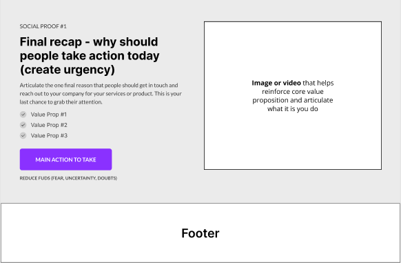

### Sections

| # | Section | Purpose and content |
|---|---------|-------------------|
| 1 | **Hero** | Social proof #1 line · dream outcome headline · pain-point subtext · CTA · FUD line ("100% free · No obligation · Takes X minutes"). Right: offer card (what you get, with ticks, a button and an email fallback) or the form itself. |
| 2 | **Social proof #2 strip** | |
| 3 | **Social proof: 3 cards** | Testimonials · CTA. |
| 4 | **Pain point** | The cost of not knowing, and why this offer is the easy first step · CTA. |
| 5 to 7 | **Value props #1 to #3** | What the visitor gets from the offer, alternating image and text. |
| 8 | **Social proof: 1 wide card** | Stats row · CTA. |
| 9 | **Differentiators** | 6 reasons to take the offer (free, quick, built for your industry, and so on) · CTA. |
| 10 | **How it works** | 3 steps from start to result · CTA. |
| 11 | **Meet the team** | · CTA. |
| 12 | **Guarantee (optional)** | One wide card with a seal icon. Use only a promise the business has approved · CTA. Then a **Social proof #2 strip**. |
| 13 | **FAQ** | 6 questions: is it free, how long, who it's for, what happens after, privacy, how it compares to the paid service. |
| 14 | **Final recap** | Urgency headline · 3 ticks · CTA · FUD. |
| 15 | **Minimal footer** | |

---

## Copy rules

- **Every section ends with a CTA.** Vary the wording ("Book a Compliance Audit", "Find My Compliance Gaps", "Start Step 1 Now"), but it always leads to the same main action.
- **Headlines are benefits,** written from the customer's side: the outcome, not the feature.
- **Name the "old way"** in pain-point sections, then position your way as the fix.
- **FUD lines under main CTAs** remove friction: free, no obligation, timeframe, no jargon.
- **Proof everywhere:** stars line in the hero, a trust strip under it, and proof sections between the value sections.
- **Plain language.** No jargon, short sentences, local spelling (for example South African English: "prioritised", "organised").

## Design system (from the VDW build, so swap the colours per brand)

- **Colours:** take them from the logo. One main colour (VDW: sky blue `#22a9e1`, dark `#0b78a8` for text), one CTA colour that stands out (VDW: orange `#f39219` with dark text for contrast), a dark neutral for text and strips (`#1f2429`), and light grey section backgrounds (`#eeeff1`). Alternate white and grey sections.
- **Fonts:** Inter (headings, 700 to 800) and Lato (body).
- **Buttons:** large, uppercase, bold, rounded 8px, with a soft shadow.
- **Cards:** white with a 1.5px dark border and 10px radius. Icons sit in light-tinted rounded squares.
- **Image boxes:** until real photos arrive, use designed mock-ups (scorecards, checklists, dashboards) or icon panels with labels. Never use stock-looking placeholders on a live site.
- **Responsive:** 3-column grids become 2 columns on tablet and 1 on phone, image and text pairs stack, and the menu becomes a hamburger. Check that nothing scrolls sideways at 390px width.
- **Behaviour:** sticky header, FAQ accordion (one open at a time), every page opens at the top.

## Placeholder checklist before going live

- [ ] Real phone number (header, footer, tel: links)
- [ ] Real testimonials (confirmed by the client)
- [ ] Real stats
- [ ] Team and site photos
- [ ] Guarantee wording approved
- [ ] Privacy and POPIA statements confirmed
- [ ] FAQ facts checked (timeframes, process, pricing approach)
- [ ] CTA links point to the real booking or assessment page
